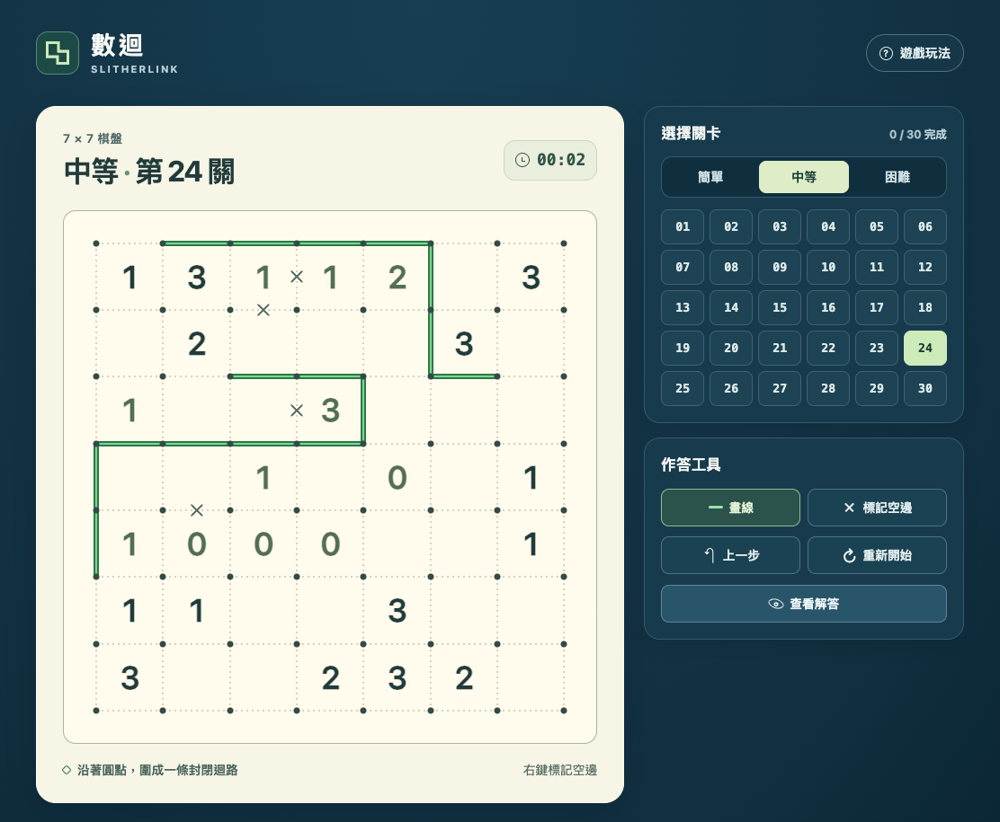
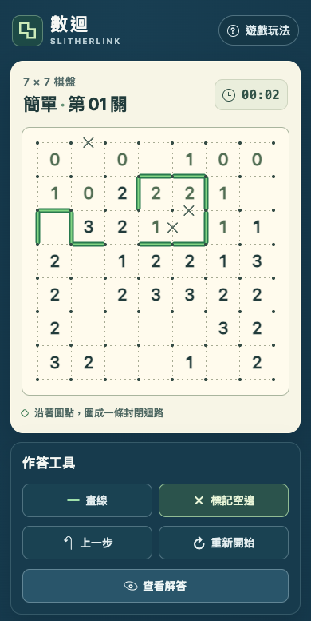
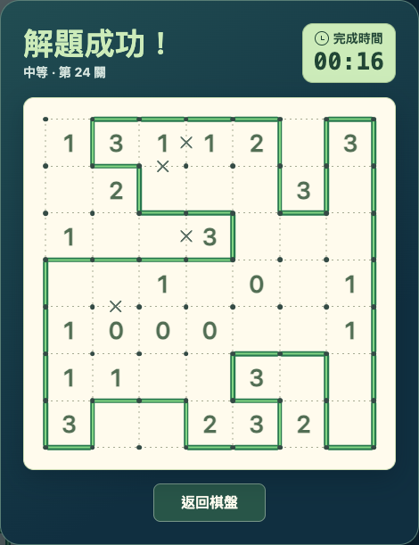

# 數迴 Slitherlink

看完《魔鬼的計謀》第 3 季的放逐區挑戰，想換自己上場？選擇 7×7 或 9×9 棋盤，跟著數字畫線，看看你多快能把所有線段連成一條封閉迴路。

**[立即挑戰數迴](https://slitherlink.zangzhen-games.workers.dev/)** · 手機、平板、電腦點開就能玩，免登入、免安裝。

這是粉絲自製的數迴遊戲。兩種棋盤都有簡單、中等、困難三種難度，每種難度各有 30 道原創關卡。每關都能直接選，也可以重玩挑戰自己的最快紀錄。

## 遊戲畫面

[](https://slitherlink.zangzhen-games.workers.dev/)

<p align="center">
  
  
</p>

## Cloudflare 部署

遊戲由 Cloudflare 直接提供 `public/` 的靜態檔案。靜態檔案請求不占用 Workers Free 的每日程式執行額度。 [Cloudflare 靜態資源計費](https://developers.cloudflare.com/workers/static-assets/billing-and-limitations/#billing)

進度與最佳時間按棋盤尺寸和關卡儲存在各自的瀏覽器。遊戲檔案包含題目與解答，任何訪客都可以讀取。

### CI/CD

GitHub 儲存庫已連接 Cloudflare Workers Builds。正式部署分支是 `main`，專案根目錄是 `/`，預覽建置已關閉。

| 設定 | 值 |
| --- | --- |
| Build command | `npm test` |
| Deploy command | `npm exec --yes --package=wrangler@4.166.0 -- wrangler deploy` |

每次推送到 `main` 都會先執行測試，通過才會部署。可到 Cloudflare 的 `slitherlink` Worker 的 **Deployments** 查看建置紀錄，也可在 GitHub 的提交頁面查看檢查結果。

### 手動部署

先用 Wrangler 登入具備部署權限的 Cloudflare 帳戶，再測試並部署。

```sh
npm exec --yes --package=wrangler@4.166.0 -- wrangler login --scopes account:read user:read workers:write workers_scripts:write
npm test
npm exec --yes --package=wrangler@4.166.0 -- wrangler deploy
```

## 手動啟動家庭 Wi-Fi 版

在 Mac 安裝 Node.js 22 以上，然後在這個專案資料夾開啟「終端機」。遊戲無額外套件。每次要開放給家人玩時，執行下列指令。

```sh
npm run start:lan
```

終端機會顯示這台 Mac 的 Wi-Fi 遊戲網址，例如 `http://192.168.1.20:8787/`。將**終端機顯示的實際網址**分享給家人，請他們連上相同的家庭 Wi-Fi，再用手機、平板或電腦的瀏覽器開啟。

伺服器只綁定這台電腦的指定私有 IPv4 位址，並接受同一子網路的裝置。遊戲資料由這台電腦提供，不需要上傳到雲端或在路由器設定連接埠轉送。玩遊戲時請讓 Mac 保持開機、清醒並連著 Wi-Fi，並讓啟動遊戲的終端機保持開啟。在該終端機按 `Ctrl+C` 即可停止服務。

### 手動選擇 IP 或連接埠

若無法自動辨識 Wi-Fi，在 macOS「系統設定 → Wi-Fi → 詳細資訊 → TCP/IP」查看這台 Mac 的 IPv4 位址。把下面指令的範例位址換成該位址。`--port` 可省略，預設為 `8787`：

```sh
npm run start:lan -- --host 192.168.1.20 --port 8787
```

若只想在自己的電腦玩，執行 `npm start`，然後開啟 `http://127.0.0.1:8787/`。

### 家人的裝置連不上時

- 確認 Mac 和家人的裝置使用同一個家庭網路，有些訪客 Wi-Fi 會隔離裝置。
- 若安裝了多個 Node 版本，執行 `node -p 'process.execPath'` 可查出實際執行檔。若預設版本的入站連線已被防火牆擋下，請使用這台 Mac 上已可接收入站連線的 Node 版本。
- 如果 Mac 的 Wi-Fi IP 改變，重啟遊戲伺服器並分享新的網址。希望網址固定時，可在家中路由器替這台 Mac 保留 DHCP 位址。

## 玩法

- 數字代表該格四邊必須畫上的線段數。空白格沒有這項限制。整盤的所有線段須連成一條封閉迴路。
- 在棋盤選擇畫線或叉號工具，然後點按邊線套用。滑鼠也可用右鍵切換叉號。
- 第一次動作開始計時。切離頁面、查看解答或完成關卡時，計時暫停。
- 可復原上一步、重新開始目前關卡，或開啟解答。查看解答會保留原本的作答進度，回到棋盤即可繼續。
- 解題成功時會顯示本次用時與完成的棋盤。簡單在 1 分 30 秒內、中等在 2 分 30 秒內、困難在 3 分鐘內過關時，會顯示「超厲害！！」並從 13 張特殊獎勵圖中隨機抽一張。超過時限時，從八個角色和「聖誕節」共九個類別中隨機抽選，簡單抽一類、中等抽兩類、困難抽三類。同一場慶祝的類別不重複，每個抽中的類別會再隨機顯示一張圖。原有角色各有三張圖，聖誕節有十張。關閉慶祝視窗後，可從棋盤下方再次查看用時與棋盤。

聖誕節的十張圖和小桃鼠的第一張圖來自使用者提供的附圖。其餘角色圖案取自原作者ナガノ的官方插畫。[吉伊卡哇](https://x.com/ngnchiikawa/status/1791382575224918090)、[小八貓](https://x.com/ngnchiikawa/status/1792047818057879657)、[兔兔](https://x.com/ngnchiikawa/status/1791663540459405427)、[小桃鼠](https://x.com/ngnchiikawa/status/1789632960498630776)、[栗子饅頭](https://x.com/ngnchiikawa/status/1792947761056227526)、[海獺](https://x.com/ngnchiikawa/status/1792409035351998486)、[風獅爺](https://x.com/ngnchiikawa/status/1794293076883894320)、[古本屋](https://x.com/ngnchiikawa/status/1794305980496544239)。

## 出題與難度設計

生成器依棋盤尺寸擴張、修整一塊區域，只接受外框始終是一條封閉迴路的形狀。外框就是解答。接著數每格四邊有幾條解答線，把部分數字留白。每次留白都用求解器檢查，只有仍保有唯一解的題目才會收錄。

在 `scripts/generate-puzzles.mjs` 可依尺寸和難度調整以下條件。

| 參數 | 控制項目 |
| --- | --- |
| `areaRange` | 迴路包住的格數範圍 |
| `minZeros`、`maxZeros` | 可見的 0 最少與最多幾格，優先隱藏超過保留數量的 0 |
| `minClues`、`maxClues` | 題面保留幾格數字，其餘留白 |
| `minNodes`、`maxNodes` | 求解器的搜尋節點範圍，作為難度分級的指標 |

各尺寸的每個難度有 30 關，依求解器的搜尋節點數排序。

### 7×7 題庫

| 難度 | 迴路包住的格數 | 可見的 0 | 保留的數字 | 搜尋節點數 |
| --- | ---: | ---: | ---: | ---: |
| 簡單 | 18–32 | 1–13 | 31–35 | 1–11 |
| 中等 | 33–35 | 2–4 | 24–26 | 81–275 |
| 困難 | 36–40 | 0 | 26–28 | 507–2,459 |

### 9×9 題庫

| 難度 | 迴路包住的格數 | 可見的 0 | 保留的數字 | 搜尋節點數 |
| --- | ---: | ---: | ---: | ---: |
| 簡單 | 32–48 | 5–24 | 52–59 | 1–19 |
| 中等 | 49–53 | 3–6 | 40–49 | 39–299 |
| 困難 | 56–59 | 0 | 40–50 | 319–1,793 |

### 重建題庫

每個尺寸和難度各用固定種子。修改設定後可重建對應的題庫，再執行測試。替換已上線的題目時，須在 `public/game.mjs` 更新對應題庫的作答儲存鍵，讓新題有獨立的進度和最佳紀錄。

```sh
node scripts/generate-puzzles.mjs    # 重建 7×7 題庫 public/puzzles.mjs
node scripts/generate-puzzles.mjs 9  # 重建 9×9 題庫 public/puzzles-9.mjs
npm test
```

## 測試

```sh
npm test
```
